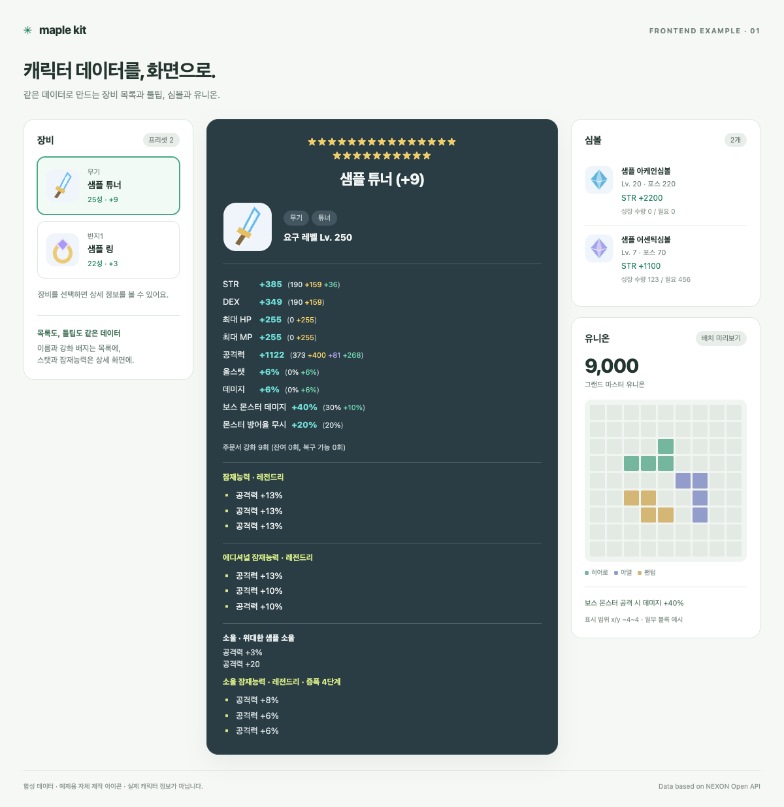

# 데이터에서 화면까지

`to_view()` / `toView()`는 화면에 쓸 이름, 아이콘 URL, 표시 문자열, 스탯 행을 반환합니다. 서비스는 이 데이터를 받아 원하는 레이아웃과 색상으로 보여주면 됩니다.

[시작하기](usage.md) · [모델 상세](reference.md#장비-숫자-접근과-툴팁)

## 이런 화면을 만들 수 있어요



실행 가능한 [HTML 예제](examples/view-demo.html)를 브라우저에서 렌더링해 캡처한 이미지입니다. 왼쪽 장비를 선택하면 툴팁이 바뀝니다. 모바일에서는 세로로 배치됩니다.

이 화면의 캐릭터 수치와 아이콘은 **공개 문서용 샘플**입니다. 실제 캐릭터 정보를 가져오면 응답의 `icon_url`에 해당 게임 아이콘 URL이 들어갑니다. 예제는 직접 제작한 SVG 아이콘을 사용하며, 사용자의 API 키나 실제 캐릭터 응답을 포함하지 않습니다.

## 화면의 각 부분은 어디서 오나요?

| 화면 | 사용하는 데이터 | 프론트엔드에서 하는 일 |
| --- | --- | --- |
| 장비 목록 | `equipment.items`: `name`, `icon_url`, `badges` | 선택 상태와 배치 |
| 툴팁 제목 | `item.display_name` | 제목 스타일 |
| STR·공격력 등 | `item.stat_rows`: `label`, `value_text`, `components` | 행 배치와 출처별 색상 |
| 잠재능력 | `item.potential`: `grade_label`, `lines[].text` | 등급 색상 |
| 에디셔널·소울 | `additional_potential`, `soul` | 데이터가 있을 때 섹션 표시 |
| 심볼 카드 | `symbols.items`: `icon_url`, `level_text`, `force_text`, `stat_rows`, `growth` | 카드 배치 |
| 유니온 레벨 | `union.basic.level`, `union.basic.grade` | 숫자·등급 표시 |
| 유니온 블록 | `union.raider.blocks[].positions` | x/y 좌표를 격자로 표시 |

예제의 유니온 보드는 x/y −4~4 범위의 일부 블록만 보여줍니다. 전체 보드의 크기·좌표 변환·색상은 서비스에서 결정합니다. 심볼 성장 수량은 원본의 현재·필요 수량을 그대로 표시합니다.

## 백엔드: 화면용 데이터를 반환하기

장비·심볼·유니온을 선택해 가져온 `character`가 있다고 가정합니다.

**Python**에서는 dict를 반환합니다.

```python
page = character.to_view()
# 사용하는 웹 프레임워크에서 page를 JSON 응답으로 반환하세요.
```

**Java**에서는 Map을 반환합니다.

```java
var page = character.toView();
// 사용하는 웹 프레임워크에서 page를 JSON 응답으로 반환하세요.
```

프론트엔드가 받는 JSON은 두 언어에서 같습니다. 장비 하나만 필요한 응답은 `item.to_view()` / `item.toView()`로 만들 수 있습니다. API 키는 이 응답에 포함되지 않습니다.

## 프론트엔드: 문자열을 다시 파싱하지 않고 표시하기

예를 들어 장비의 스탯 한 행은 다음과 같습니다.

```json
{
  "key": "STR",
  "label": "STR",
  "value": "385",
  "unit": "FLAT",
  "value_text": "+385",
  "text": "STR +385",
  "breakdown_text": "190 +159 +36",
  "components": [
    {"source": "BASE", "label": "기본", "value": "190", "text": "190"},
    {"source": "STARFORCE", "label": "스타포스", "value": "159", "text": "+159"},
    {"source": "ADDITIONAL", "label": "추가옵션", "value": "36", "text": "+36"}
  ]
}
```

React에서는 다음처럼 렌더링할 수 있습니다. 스탯의 부호와 단위는 라이브러리가 붙여 줍니다.

```jsx
function ItemStats({ item }) {
  if (item.stat_rows == null) return <p>스탯 정보를 확인할 수 없습니다.</p>;
  return <dl>
    {item.stat_rows.map(row => <div key={row.key}>
      <dt>{row.label}</dt>
      <dd>
        <strong>{row.value_text}</strong>
        {row.components.length > 0 && <span> (
          {row.components.map(component => <span
            key={component.source}
            className={`stat-${component.source.toLowerCase()}`}
          >{component.text}{" "}</span>)}
        )</span>}
      </dd>
    </div>)}
  </dl>;
}
```

```css
.stat-base { color: #dbe3e5; }
.stat-starforce { color: #f3cf67; }
.stat-scroll { color: #b1a5ec; }
.stat-additional { color: #70d6b2; }
.stat-exceptional { color: #ec9ccc; }
```

위 색상은 어두운 툴팁 배경을 기준으로 합니다. 배경과 색상은 서비스에 맞춰 바꾸세요. 전체 실행 예제는 프레임워크 없이 동작하는 HTML/CSS/JavaScript로 작성했습니다. [실제 렌더링 코드 보기](examples/view-demo.html)

## 예제 직접 열어보기

저장소를 내려받았다면 **`docs/examples/view-demo.html`을 브라우저로 여세요.** 같은 폴더의 `view-data.js`도 필요합니다. 서버 실행, API 키, 프론트엔드 패키지 설치 없이 동작합니다.

```sh
# macOS에서 저장소 루트 기준
open docs/examples/view-demo.html
```

샘플 데이터도 직접 입력한 화면용 JSON이 아니라, 합성 API 응답을 라이브러리로 변환한 결과입니다. 설치한 라이브러리 기준으로 다시 생성하려면 다음 명령을 실행합니다.

```sh
python tools/build_frontend_example.py
```

- [샘플 생성 코드](../tools/build_frontend_example.py): 합성 응답 → `Character.to_view()`
- [생성된 화면 데이터](examples/view-data.js): 화면에서 읽는 결과
- [HTML 예제](examples/view-demo.html): 실제 렌더링과 장비 선택 동작

GitHub의 HTML 파일 링크는 소스 코드 화면으로 열립니다. 실행 화면은 위 PNG로 보거나, 파일을 내려받아 로컬 브라우저에서 확인하세요.

## 데이터가 없을 때는?

`null`과 빈 목록 `[]`을 다르게 처리하면 됩니다. `character.to_view()`의 `sources`에서 미선택·실패·날짜 미지원 여부를 확인할 수 있습니다.

```jsx
if (page.equipment == null) {
  return <p>장비 정보를 사용할 수 없습니다: {page.sources.EQUIPMENT.status}</p>;
}
if (page.equipment.items == null) return <p>장비 목록을 확인할 수 없습니다.</p>;
if (page.equipment.items.length === 0) return <p>장착한 장비가 없습니다.</p>;
```

잠재능력·소울이 `null`이면 그 섹션을 숨기면 됩니다. 해석되지 않은 옵션도 `lines[].text`에 원문이 남아 있어 표시할 수 있습니다. 수치의 정밀도와 진단 규칙은 [API 참고](reference.md#부재오류정밀도-계약)에 정리했습니다.
